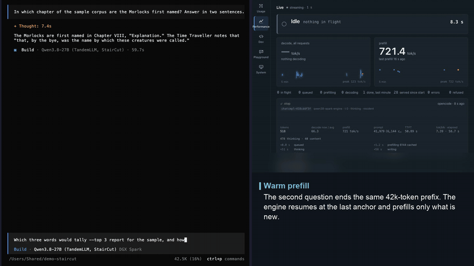

# Caches

A long prose prompt sent twice took 44.4, 93.7 and 208.3 s to its first token at 32k, 64k and 128k tokens from cold, and 0.3, 0.6 and 1.1 s the second time, resumed from the resident prefix (the paper, one request each, published NVFP4 set). A prefill is the most expensive thing the engine does, and the caches exist so that it runs once per token of a conversation instead of once per turn.

Every cache here restores exact state, and none of them is meant to change the output. [exactness.md](exactness.md) says precisely what "exact" means for each, and what has been measured.

## What a state is

To continue a sequence at token L, the engine needs:

- the KV rows of the 16 attention layers for tokens 0 to L (64 KB a token);
- the 48 recurrent states and their convolution tails (about 147 MiB, whatever L is);
- the drafters' own position-indexed KV (about 40 KB a token for both drafters).

The recurrent part is the hard one. A KV row depends only on the tokens up to it, so rows written for an earlier request stay valid. The recurrent state has absorbed every token and cannot be rewound, so a cache must have taken a copy at L.

## The caches

| cache | what it keeps | where | default |
|-|-|-|-|
| resident prefix | the KV the last prefill and generation wrote, in place, plus recurrent-state anchors every 1,024 tokens and one at the end of the last generation | device memory | on, 4 GiB of anchors, 147 MiB for the end |
| state store | whole state snapshots at prompt boundaries (session cache) and chunk boundaries (prefix cache) | device memory | on, 8 GiB in the served profile |
| persistent suffix store | token ids the engine read and wrote, with a suffix array | disk, outside the repository | on |
| response cache | the tokens of an identical greedy request | memory | off |
| disk tier | rows and recurrent-state anchors of prefixes prefilled more than once, and of a session's first long request | NVMe | off in the code, on in the served profile from 0.3.13-test, 50 GB |

## Resident prefix

An agent client such as opencode sends one conversation that only grows: each turn's prompt is the previous prompt, plus the previous answer, plus a tool result. At 190k tokens a whole snapshot would be about 20 GB, so the state store cannot keep one.

`engine/cache.py::ResidentPrefix` uses the observation that the previous prompt's KV is still in the engine's own buffer, row for row. It leaves the KV in place and clones only the recurrent state and convolution tails (146.8 MiB) at every 1,024-token boundary of the prefill. These copies are called anchors. A new request that shares the first c tokens of the resident prompt resumes at the largest anchor at or below c. The engine copies the recurrent state back, sets the KV length, tells the drafters their caches are valid up to there, and prefills the rest.

| first turn: cold prefill | next turn: resumed from the anchors |
|-|-|
|  |  |

*The first turn of a ~42k-token opencode session prefills everything; the next turn resumes from the anchors and its prefill bar starts near the end. Recorded against the served engine (published NVFP4 weights, StairCut on); sped-up parts are marked in the clip.*

Resuming this way computes the same state as a cold prefill on the same grid. Anchors come only from prefill chunks, never from rows a verify round wrote, and the resumed request forwards the rest of its prompt on the same 1,024-token grid a cold prefill uses. `tests/test_resident.py` checks, on a small random model, that the resumed logits, recurrent state, convolution tails and KV rows equal a cold prefill's bit for bit. In the paper's long-context check on the real model, the cold and the resumed request wrote the same 256 tokens at 32k and 128k and different ones at 64k; that difference is not explained.

A short unrelated request between two turns, such as a title request, would overwrite rows the conversation needs. Such a guest request (much shorter than the resident prompt, and at most `--resident-guest-max` tokens, 8,192) gets the rows it can reach copied aside first, into a 1 GiB stash (`--resident-stash-gb`, the guest's rows and a 512-row margin), and they are copied back before the next request. The 2.5 GiB anchor budget (`--resident-gb`) holds 17 anchors, and the newest 4 are never evicted, because the next turn resumes near the end.

Grid anchors make every turn re-read the previous prompt from its last 1,024-token line (on one night of opencode traffic, 507 tokens a turn at the median for 197 new ones). Resuming at a finer line was built and measured: a forward that starts at a 64-row line inside a grid chunk does not reproduce the rows of the cold forward over that chunk on the served kernels (logits, states and KV of 4 resumed turns at 49k to 202k tokens all differed from a cold prefill's), so it is not in the engine.

A request too long to be a guest replaces the resident prompt. opencode's compaction request is one: no tools, no system text, the history as one user message, sharing nothing with the conversation, and the turn after it starts with the same tool block and system text as every turn before. Before such a request cuts the rows, the head of the old prompt is pinned: its KV rows and up to 8 anchors spread over it (the anchors every 4,096 tokens up to 32,768, which eviction keeps for this) are copied aside, as long a head as `--resident-pin-gb` holds (4 GiB with its anchors, about 33,000 tokens; its own budget, no longer taken out of the state store's). A later request that shares more with the pinned head than with the rows in place gets them copied back and resumes at the largest pinned anchor it shares. `tests/test_resident_pin.py` checks the resume against a cold prefill bit for bit.

Two sessions used in turn (A, then B, then A) share their head and nothing after it, and each switch re-read the other session past the head. When a request of another session (the body's conversation id, else opencode's `x-session-id`; without either, a prompt that parts from the rows in place) replaces the resident prompt, the rows it is about to overwrite, from where the two part up to the replaced prompt's newest anchor that fits, are parked with its newest 4 anchors (`--resident-park-gb`, 4 GiB, about 35,000 tokens past the head). A later request that shares more with the parked prompt than with the rows in place gets them back: the parked rows and the rows in place are swapped a block at a time, so B is parked while A comes back. The shared head has to be in place. A parked prompt is not pinned as well, and a compaction drops its session's parked rows instead of parking them. In a hold on 2026-10-01, A came back after B with 41,984 of 53,209 tokens reused and 11,225 re-read in 16.4 s, where it would have re-read about 45,000. `tests/test_resident_park.py` checks every swap against a cold prefill bit for bit.

### After a long generation

The rows a generation writes are never anchored on the prefill's grid, and until 0.3.14-test the resident prefix held the turn's prompt, not its answer: the next turn shared at most that prompt with it and resumed at its last anchor, so it re-read the whole previous output. A session snapshot would hold the state after the generation, but it costs about 151 MB plus 104 KB a token, and a long session's is over the served entry cap (`STORE_ENTRY_GB=1`, about 7,000 tokens) and the whole store (`CACHE_GB=2`). Measured on 2026-10-02 (rrr2, opencode): turn 1 prefilled 34,038 tokens and thought 32,773, closed by the D2 backstop with the hidden phrase; turn 2's 66,964-token prompt resumed at 33,792 = 33 × 1,024 and re-read 33,172 tokens in about 44 s. Every one of that session's 15 turns, and the 18:08 session's, resumed at the previous prompt's last 1,024 line, whether the monitor had hidden a phrase or not (`tests/test_reread_after_think.py`).

The end anchor (0.3.14-test, `--end-anchor`, `END_ANCHOR` in serve.env, on). At the end of every generation `ResidentPrefix.keep_end` keeps one more anchor: the recurrent states and convolution tails at the last position the engine forwarded (147 MiB, the same two buffers turn after turn), with the rows in place marked valid up to there. A generation that stopped part way through an accepted block (the end token, a stop, the budget) has the engine a few rows ahead of the committed tokens; its pending commit is cut back to them first (`trim_pending`, as `--session-trim` cuts the session snapshot), and when the state has already absorbed them, no end anchor is kept. The next request that starts with every one of those tokens (the prompt and the answer as the client sends them back) resumes there and forwards only what is new: the turn after a 33k thinking forwards its tool result and the template's glue instead of 33,172 tokens. It is taken when it starts later than the anchors in place, the pinned head and the parked session; a state store entry or the disk only when they start later still. `cached_tokens` in the journal is then the previous prompt plus its generation, and the source is `end`.

Verify blocks wrote that state, so a resume there is the session cache's resume: the state that produced the previous answer, held to the greedy gate (the same tokens), not to bit equality with a cold prefill ([exactness.md](exactness.md#caches)). So is everything a prefill that resumed there writes. `taint`, in the resident prefix's report, is the lowest such row: an anchor above it is a resume under the same gate; the state store takes no prefix snapshot of such a prompt, the disk tier writes nothing of it and reads over those rows when it restores, and a resume at a grid anchor at or below it, or a cold prefill, is a cold grid prefill's again, bit for bit (`tests/test_end_anchor.py`). The pinned head and the parked session carry their rows' line with them. The end anchor goes when its rows do: a prompt that parts inside the generation (it resumes at the prompt's last grid anchor, as before), a pin or park swap, a store or disk restore.

The tokens the session monitor hid in an answer (a hidden close's phrase, a hidden turn, SP4's note at the prompt's tail) are in the rows and not in the client's copy, so that copy parts from the end anchor where the first of them sits. The end anchor lists them with their positions, and before the prefill the server puts them back where they sit when the prompt then starts with every token up to the end anchor (`ResidentPrefix.replay`, in the handler after the router's notes, and for the in-context stage's prompt); otherwise the prompt is served as the client sent it. They count as hidden: not in `usage`, the suffix store or the response cache, and the journal row says `extra.end_replayed`. A request with images keeps no end anchor and replays nothing.

The client's copy is text the template renders again, and next to a hidden span its whitespace is not the rows'. The template writes an assistant message as `<think>\n` + the reasoning, trimmed, + `\n</think>\n\n` + the answer; a hidden close's phrase ends in its own newline right before the visible `</think>`, so the copy holds one `\n` more than the rows where the phrase sat, and a reasoning that ended in whitespace before the phrase loses it to the trim. In 0.3.14-test's live check (2026-10-02 22:07, a client budget of 400 reasoning tokens) that one token parted the copy from the end anchor, and the follow-up re-read everything. From 0.3.15-test the replay aligns runs of whitespace-only tokens next to a span (`ResidentPrefix.glue`, the tokenizer's single tokens for newlines, spaces and a tab, `server/app.py` `glue_ids`): every other token of the copy must be the rows' own, and what is served up to the end anchor is the rows' tokens, the context the engine had. `usage.prompt_tokens` stays the client's count.

A guest keeps no end anchor. A request much shorter than the resident prompt (`--resident-guest-max`, a quarter of it) writes over rows the resident prompt's next turn needs, which the stash puts back before the next request; the guest's own rows and its end go with that. So a short conversation that starts while a longer one is resident re-reads its first answer at its second turn, as it re-reads its whole prompt on every turn (0.3.14-test's live check: a 459-token first turn after a 1,932-token conversation was a guest, and its follow-up resumed nowhere). Keeping a guest's end beside the stash is not built: the router's classifier requests run between such a conversation's turns as guests of their own, and they would write over the guest's rows in turn.

Whether the client's copy matches: in the box's suffix store on 2026-10-02 (4,607 turns that followed another, token ids only), the next prompt held the engine's visible output token for token to its end in 3,844 (83 %); where it did not, it parted late (91 tokens before the end at the median), and such a turn resumes at the prompt's last line, as before. The 147 MiB are asked of the memory policy once, at the `end` level: given back after the body anchors and before the guest stash (`Budget.LEVELS`). Anchors every 1,024 generated tokens, which would also serve a copy that parts inside the generation, are not built.

## State store

`engine/cache.py::StateStore` keeps whole snapshots, keyed by the tokens that produced them. It serves two uses with one object.

The session cache keeps a conversation's state after its turn ends. The next turn starts with all those tokens and forwards only the new message. This state was written by verify rounds rather than prefill chunks, so it is the state that produced the previous answer, and not the state a cold re-read would compute. It is held to the greedy gate (same tokens) rather than bit equality.

The prefix cache takes a snapshot at the longest `--prefix-chunk` boundary of a prefill that fits the per-entry cap (`--store-boundaries`, default 1; 0 takes one at every boundary, where one cold prefill's nested snapshots fill the budget and evict everything else). A request whose prompt starts with a prefix an earlier request already read resumes at the longest snapshot they share. A shared system prompt then costs nothing from the second request on. These resumes land on the chunk grid, and `tests/test_cache.py` checks, on a small random model, that their logits equal a cold prefill's bit for bit.

A generation usually stops part way through a verified block's accepted path (at the end token, a stop or its budget), so the engine has forwarded tokens the turn never committed and the session snapshot has no key. `--session-trim on` cuts the block's commit, which is still pending when the commit is folded into the next verify, back to the committed tokens before the snapshot. It is off by default because a session resume is held to the greedy gate, not to bit equality with a cold prefill. The log line of a declined put names the reason, and `declined_big` and `declined_short` count them.

A snapshot is about 151 MB of recurrent state plus about 104 KB a token of target and drafter KV. The budget therefore counts conversations long before it counts tokens. The served budget is 2 GiB (`CACHE_GB`), and a single snapshot may take at most 1 GiB (`--store-entry-gb`, about 7,000 tokens): under opencode the store serves short chats only, and longer sessions are the resident prefix's. Room is made before a snapshot is cloned (`StateStore.reserve`), not after: at 24 GiB, a large snapshot cloned before eviction ran on top of 53 GB of engine and 40 GB of page cache, and it took the board to zero free memory.

Every hit re-checks the stored tokens element by element before restoring anything. A hash is a hint here, never an answer, because a 64-bit collision would answer one request with another request's state.

## Images in a prompt

An image's prompt rows are placeholder tokens, and the placeholder is the same token for every image. A cache keyed on the tokens would answer a request with another image's state. That is why `cache.prefill` takes `key_ids`: the prompt with each image's rows replaced by an id taken from a digest of the preprocessed patches and the grid. The state store, the resident prefix, the session state and the response cache all compare those ids, so the same URL with new pixels misses and the same pixels under another URL hit. The tower's output is cached by the same digest (`--image-cache-mb`, 512), so a conversation that sends an image on every turn, as Open WebUI does, encodes it once. The persistent suffix store never receives placeholder rows.

## The chunk size is a real trade

With the prefix cache on, every prefill runs in chunks of `--prefix-chunk` tokens, so that warm and cold runs do the same arithmetic. A chunk costs a full read of the weights. On a 1,724-token prompt a cold prefill took 2,508 ms in one piece, 2,858 ms in chunks of 1,024 and 3,940 ms in chunks of 256. The default is 1,024, because a prompt nobody shares pays the cost and gets nothing back. Drop it to 256 when many requests share one long system prompt.

## Persistent suffix store

`engine/cache.py::PersistentSuffixStore` is an append-only log of token ids that this engine has read and written, with a suffix array over it. The lookup drafter reads it beside the corpus ([speculative-decoding.md](speculative-decoding.md)), so text from an earlier session can be drafted at a 0.2 ms lookup.

It holds token ids and never text. Its directory is created with mode 0700, outside the repository, and capped by `--suffix-store-mb` (192 MiB, about 48 million tokens). Over the cap it forgets the oldest half at the next document boundary. `--suffix-store-scope outputs` keeps only what the engine wrote. The store records the tokenizer's sha256 and refuses to open with a different tokenizer; a store written before the fingerprint existed gets it recorded the next time it is opened for writing.

A request adds its prompt and its output, minus what one of the last four requests already added: a prompt that starts with an earlier prompt appends only from the point where they part, with the 8 tokens before that point in front, so every n-gram across the join is still in the store. An agent conversation sends the same growing prompt every turn; appending it whole wrote about 200 copies of one conversation in a night (397.5 million tokens for about 4.8 million new ones), rebuilt the suffix array after every turn and trimmed away the store's older content. `/health` reports the rebuilds' total time (`rebuild_ms_total`) beside the last one's.

A store that has seen a benchmark's prompts inflates that benchmark. On one release candidate it added about 21 % to the benchmark row. Benchmarks therefore run with the store off, or with a clean store that never held their text, and `--suffix-store-readonly` keeps a benchmark from writing itself into a store of real traffic ([measurement.md](measurement.md)).

## Disk tier

Every opencode session starts with the same 24,000 to 30,000 tokens (the reasoning header, opencode's system text, the tool block), and a cold prefill of 30,000 tokens takes about 44 s. The resident prefix serves that head only while its rows are the ones in the engine's buffer; a restart, a deploy, a long unrelated request or a day of other sessions throws them away. `engine/disk_cache.py::DiskTier` keeps them on the NVMe, under the caches in RAM.

It stores what a restore needs in two kinds of file, on the prefill's 1,024-token grid, as the resident prefix keeps them in memory:

- a chunk file holds rows `b - 1,024` to `b` of every position-indexed buffer (the 16 attention layers' KV, and the drafters' own) and those 1,024 token ids, keyed by the hash of the whole prefix up to `b`. A row depends only on the tokens before it, so two prompts that share 30,000 tokens share 30 chunk files, and a prompt that extends one writes only its new chunks. 104 MiB a chunk on the served stack (106,496 bytes a token);
- an anchor file holds the 48 recurrent states and their convolution tails at one line (147 MiB), keyed the same way, with the hashes of the chunks below it. An anchor is usable when every chunk below it is on disk.

What is written is decided before the prefill runs. Every grid line a prefill forwards cold is counted by its hash (resumed lines are not: the count is the work the tier would have saved), and the longest line of the prompt counted `admit_after` times (2) gets an anchor. The first long request of a session (opencode's `x-session-id`) gets anchors at the last 4 lines below where its last user message starts (`--disk-cache-head-anchors`), because the next session in the same folder parts from it there. The chunks below those anchors that are not on disk are written too. Prompts under `--disk-cache-min-tokens` (4,096) are not, and neither is anything from a request that started from a session snapshot (verify blocks wrote those rows).

A session in another folder parts much earlier. The Qwen3.8 template renders the tools first, then opencode's system text: its fixed prompt, then the `<env>` block (the model id, the working directory, whether it is a git repository, the platform, the date), then the instruction files found from the folder up (AGENTS.md, CLAUDE.md) and the skills list, then the user's message. On 2026-10-03 the disk tier's heads of two eval sessions in two folders (opencode 1.18.34, the same tools) were equal for 13,954 of 25,616 and 27,659 tokens, up to the working directory's path; a head with two MCP tools more parted from both at 9,468, inside the tool block. Nothing after the `<env>` block can be reused across folders without changing the prompt the client sent, so the most a new session in a new folder resumes is the grid line below that point, 13,312 tokens (52 % of that prompt). The second of those sessions (00:09, 25,616 tokens, right after the eval's `POST /v1/cache/clear`, which empties the caches in RAM) prefilled cold in 35.3 s: the first (23:28) had written its head anchors at 20,480 to 23,552, past where the second parted, and a line is admitted at its second cold read, which was this one; it wrote the anchor at 13,312 that the third session reads.

Two rules (0.3.18-test) make that line come sooner:

- a branch: a line counted `admit_after` times whose count falls at the next line, where an earlier prompt read this far and went on differently, gets an anchor too (the 4 longest, `BRANCH_MAX`, and only in the head two sessions can share, up to where the conversation's first answer starts). The longest repeated line is that line only when the prompt shares nothing more with an earlier one; a session in a folder seen before shares its own folder's `<env>` block and instructions with that earlier session, and without the branch the other folders' line would wait for a cold read of its own;
- the counts outlive a new fingerprint. A deploy that changes the engine's code sweeps every file, and with the files the counts went, so the first two sessions after every such deploy prefilled the shared head cold. The counts are traffic, not rows (a line's hash and how often it was read cold); they are kept on the same grid, and only the dashboard's clear drops them. They decide what is written, never what is read: a restore compares every token of every chunk with the prompt whatever the counts said, and its arithmetic is the tier's, bit for bit a cold prefill's.

`tests/test_disk_cache.py` plays the case on the small random model: two sessions in two folders, a deploy, a third session in the first folder (it writes the branch line, its own head and its repeated line), and a fourth in a new folder, which resumes from the disk at the branch line and equals a cold prefill bit for bit.

The writes never hold a request. An anchor's state is copied to a staging slot on the engine thread as the prefill passes its line (a few milliseconds between two chunk forwards); the rows stay where the prefill wrote them, and a writer thread copies them out after the prefill and writes them while the request decodes, which writes only rows past the prompt. The next prefill fences the job: rows it is about to write are no longer copied, and what was not copied by then is dropped and journaled (`window`). A turn that resumes from the resident prefix above the job's line leaves its window open.

The lookup comes after the resident prefix, the pinned head, the parked session and the state store. A disk anchor is taken only when it starts later than all of them and its read costs less than the prefill it saves (the read at the tier's measured rate against 740 tokens a second, the fastest cold prefill measured). Only the chunks above the rows already in place are read. Before a byte reaches the engine, every chunk's stored token ids are compared with the prompt's element by element, and each file's sections are checked against their crc32. The chunks stream through the staging buffer into the engine's own buffers, the anchor into the recurrent state, and the restored prompt becomes the resident prompt with the disk anchor as its anchor. A file that fails its check is deleted with every longer chunk of its chain, and the request resumes from the rows in place or starts cold; the prefill that forwards those lines writes them again. `tests/test_disk_cache.py` checks, on the small random model and through a reopened tier, that a restored request's logits, recurrent state, convolution tails, KV rows and drafter rows equal a cold prefill's bit for bit, including after a failed restore and a closed window; `tests/test_disk_cache_server.py` checks that the served loop writes the same greedy tokens from the disk as without the tier. On the served engine, `tools/disk_restore_check.py` (a hold, the served flags, a directory of its own) does the same bit for bit, in the process that wrote the files and in a fresh one after a restart ([exactness.md](exactness.md#caches)); on 2026-10-02 both were equal everywhere.

The live check after a deploy (`tools/disk_cache_live.py`) compares what the model wrote, cold and from the disk: the text without TandemLLM's step lines (`› reading ...` and `› waiting ...` say how long something took) and each tool call's name and arguments, not the id the server draws per call. On 2026-10-02 at 22:08 it compared the raw stream and failed on those alone (the model's text and calls were the same); the restore read 15,360 tokens, 1.79 GB, in 334 ms, and the server's TTFT went from 23,106 ms cold to 2,681 ms.

On the box (`tools/disk_cache_bench.py`, 2026-10-02, CPU only, O_DIRECT, 104 MiB files): writes at 4.3 GB/s, reads at 7.35 GB/s, crc32 at 5.6 GB/s. A 30,720-token head is 30 chunks and an anchor, 3.43 GB: 0.47 s at the read rate, about 0.6 s with the checksum overlapped and 1.1 s with neither overlapped, against about 44 s of cold prefill. The first turn of a new session then costs that read plus the prefill from the anchor to the end of its prompt (its user message, 1 to 3 s). These are the arithmetic from CPU-side rates; the restore on the board is to be measured after the deploy.

The writer and CUDA graph captures (0.3.14-test). The writer is the one thread that issues CUDA calls (a copy on its side stream and its synchronize, the pinned staging buffers) outside the engine's lock. A graph capture runs in CUDA's global mode, so such a call during a capture fails and invalidates the capture: on 2026-10-02 at 21:09, the first request after the 0.3.13-test restart, the writer copied a session head's rows while the drafter captured its graph; the copy failed after 1 of the head's 15 chunks and the request ended in an error. Every capture now holds `engine/capture_lock.py`'s lock, and the writer holds it around its CUDA calls (the probe snapshots' writer too); a capture waits at most for one chunk's copy, a copy at most for one capture (`tests/test_capture_lock.py`; `tools/capture_race_check.py` runs the real writer against captures on the GPU in a hold). And an anchor counts as written only with every chunk below it on disk: a head whose chunks failed is admitted again by the next first request of a session, which writes the chunks it lacks; before, its anchors kept it from ever being admitted, and no lookup could read it.

Crash safety: each file is written to `<name>.tmp`, fsynced and renamed, and the directory fsynced; the files are the index (their headers), so a crash leaves at most a `.tmp`, which the next start deletes. A file written under another fingerprint (the weight files, the engine's code, the arithmetic flags in the environment, the grid, the torch and Triton versions) is swept at the start: the rows of another arithmetic are not a cold prefill's.

The disk: the dashboard sets the budget (50 GB by default), how long an entry nobody used is kept (7 days) and the free space the tier leaves the file system, never under 50 GB whatever is set. When it is full, the least valuable entry goes first: its hits plus one, times the tokens it saves per byte it holds alone (its file and its share of each chunk it reads), halved for every day unused. Chunks no anchor reads go with the last anchor that read them. Nothing goes through the page cache (O_DIRECT, or fadvise where the file system refuses it).

Memory: the staging buffer (two anchor slots and two chunk slots, 0.5 GB on the served stack) is the tier's whole host footprint. It is allocated at the first disk read or write, page-aligned and pinned, and the residency planner counts it in the engine's declared peak until then.

`settings.memory.disk_cache` in the conductor's settings document holds `mode`, `budget_gb`, `ttl_days`, `admit_after` and `min_free_gb`, versioned like the transcript settings and applied from the next request; the Memory screen's Disk cache tab edits them, shows the free space, the hit rate, the bytes, the most-hit prefixes (their token counts, and a short preview for opencode heads and packages only, never a user's text) and the last events, and clears the tier. `--disk-cache` (`QSE_DISK_CACHE` in serve.env, which `ops/start.sh` passes to the :8000 service only) names the directory, `~/.qwen38-spark-engine/cache/disk` on the box; off, nothing of it runs. The journal gets a row of `kind` memory, `task` disk_cache, for every hit, write, eviction, drop and failed restore; `qse_disk_cache_*` are on `/metrics`.

Packages, skills and memory files are cached as part of the prefixes they sit in: an entry whose prefix holds an injected package is named by it. The same text at another position in another prompt has other rows and another recurrent state, and reusing it there is not exact, so the tier does not.

## Response cache

`--response-cache` answers an identical greedy request (same prompt, same parameters) from memory. Greedy output is a function of its input, so this is memoisation and not an approximation. It is off by default, so a benchmark can never be pointed at a dictionary by accident.

## Memory

All caches share the board's 128 GB with everything else, the weights and the KV buffer first. At the 262,144-token window the engine holds 57 GiB after its load with empty caches; what grew from there to 75 and 83 GiB on 2026-10-01 was the caches at their old caps (14.5 GiB), a long prefill's workspace, and the allocator's reserve, which kept every freed block. `engine/cache.py::Budget` holds them to three limits:

- `--mem-ceiling-gib` (70): the engine between requests, allocated plus reserve. A cache grows only while the engine stays under the ceiling less the slack, and a more valuable cache may take the room of the cheaper ones (only what nothing uses).
- `--mem-peak-gib` (77): the engine during a prefill. Before a prefill, and before the response has started, the engine's reserve goes back to the driver and then the caches, cheapest first (state store, body anchors, guest stash, parked session, pinned head), until the prefill's estimated workspace fits; a prefill that still does not fit gets a 503 with Retry-After instead of running the board out of memory. The residency planner subtracts the engine's growth to this peak before any role's claim ([operations.md](operations.md)).
- `--reserve-slack-gib` (2): the free blocks the allocator may keep between requests; over it, they go back to the driver after the request, never inside one (0.3 to 54 ms for 1 to 4.8 GiB).

In a hold on 2026-10-01 the engine held 67.25 GiB with every cache filled the way an opencode night fills them, and a 261,611-token prompt peaked at 68.35 GiB allocated with nothing given back. Every limit decides only where a prefill starts; a cache given back is the cold path. The System view's Memory plan panel shows each limit with what it holds now and edits them (the conductor's `residency` document); `qse_memory_bytes` and `qse_memory_shed_total` are on `/metrics`. The operating rule stays: keep at least 15 GiB available at the worst case, and write down the worst-case bytes of a change before raising a budget.

## Routes and knobs

`GET /v1/cache/stats` reports every cache's counters. `POST /v1/cache/clear` empties them, and needs the admin token.

| knob | what |
|-|-|
| `--cache-budget-gb` (`CACHE_GB`) | the state store's budget |
| `--no-session-cache`, `--no-prefix-cache` | turn off one use of the state store |
| `--prefix-chunk` | the prefill chunk size and snapshot grid, default 1,024 |
| `--resident-gb`, `--resident-stash-gb`, `--resident-guest-max`, `--resident-tail` | the resident prefix's anchors, guest stash, longest guest and protected tail |
| `--resident-pin-gb`, `--resident-park-gb` | the pinned head, the parked session |
| `--end-anchor` (`END_ANCHOR`) | the end of the last generation as a resume point, on; off is 0.3.13-test's resident prefix |
| `--store-entry-gb` | one state store snapshot at most |
| `--mem-ceiling-gib`, `--mem-peak-gib`, `--reserve-slack-gib` | the engine between requests, during a prefill, and the allocator's reserve |
| `--store-boundaries`, `--session-trim` | the state store's boundaries per prefill, the session snapshot's trim |
| `--prompt-token-cache` | millions of tokens of tokenised chat messages kept between requests |
| `--suffix-store`, `--suffix-store-mb`, `--suffix-store-scope`, `--suffix-store-readonly` | the persistent suffix store |
| `--response-cache`, `--response-cache-mb`, `--response-cache-ttl` | the response cache |
| `--disk-cache` (`QSE_DISK_CACHE`), `--disk-cache-min-tokens`, `--disk-cache-head-anchors` | the disk tier's directory (or off), the shortest prefix it writes, a session head's anchors; its budget, TTL, admission and on/off are `settings.memory.disk_cache` |

`POST /v1/cache/clear?tier=disk` empties the disk tier, `?tier=all` the disk and the caches in RAM.
