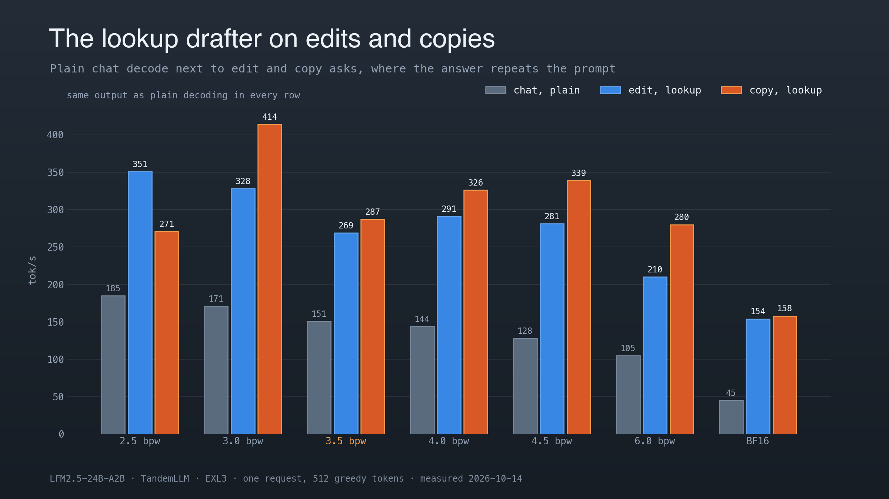

# LFM2.5-24B-A2B

LiquidAI's LFM2.5-24B-A2B is the third model TandemLLM runs, beside Qwen3.8-27B and Qwen3.8-Flash-Next, and its support ships in release 0.9.0. It has 24B parameters, and about 2B of them run for each token: a mixture of 64 experts with 4 active, in 38 of its 40 layers. It is a chat model first. On this engine it is the fast one, and its profiles trade quality for speed down to 2.5 bits a weight.

The engine's code for it is `engine/models/lfm2_moe/` (registry name `lfm2_moe`, selected by `Lfm2MoeForCausalLM` in the checkpoint's `config.json`). The Setup Guide's entry is [models/lfm2.5-24b-a2b/model.yaml](../models/lfm2.5-24b-a2b/model.yaml).

## The model

| part | what it is |
|-|-|
| layers | 40: 30 short-convolution layers and 10 attention layers (indices 2, 6, 10, ..., 38) |
| short convolution | `in_proj` from 2,048 to 3 x 2,048 (B, C, x); y = C * conv(B * x) over 3 taps, one filter a channel; `out_proj`. A sequence keeps the last 2 inputs B * x of each layer: 240 KiB |
| attention | 32 query heads, 8 KV heads of 64, q and k RMS-normed per head, rotary over the whole head (theta 1e7). KV: 20,480 bytes a token, 2.5 GiB at the full 131,072-token context |
| MLP | layers 0 and 1 dense SwiGLU (11,776 wide); layers 2 to 39 a mixture of 64 SwiGLU experts (1,536 wide), 4 a token, no shared expert |
| router | the sigmoid of each expert's logit; a per-expert bias is added to choose the 4, and the 4 chosen sigmoids are renormalised |
| head | tied to the 128,000-token embedding |

A decode token reads 4.9 GB of the BF16 weights (the pack index's `decode_bytes`: experts 2.87 GB, convolution projections 1.01, head 0.52, dense MLPs 0.29, attention 0.21). At the Spark's ~270 GB/s that is a ceiling of about 55 tokens a second in BF16, and four times that at 4 bits a weight. The weights are small next to the number of kernels a token runs (about 400), so the whole decode step is one CUDA graph.

## Profiles

| profile | on disk | weights at load | decode step, tok/s | chat, plain / lookup, tok/s | chat KL | chat top-1 | wikitext KL | the engine's chat KL |
|-|-|-|-|-|-|-|-|-|
| `lfm25-exl3-2.5` | 8.20 GB | 7.64 GiB | 188.2 | 185.4 / 175.6 | 0.313 | 78.9 % | 0.463 | 0.336 |
| `lfm25-exl3-3.0` | 9.68 GB | 9.4 GiB | 175.0 | 171.3 / 168.5 | 0.195 | 83.6 % | 0.335 | 0.217 |
| `lfm25-exl3-3.5` (default) | 11.16 GB | 10.56 GiB | 153.5 | 150.9 / 143.7 | 0.136 | 86.7 % | 0.226 | 0.151 |
| `lfm25-exl3-4.0` | 12.64 GB | 12.06 GiB | 145.9 | 143.7 / 139.4 | 0.098 | 88.5 % | 0.201 | 0.108 |
| `lfm25-exl3-4.5` | 14.12 GB | 13.31 GiB | 128.8 | 128.2 / 124.7 | 0.063 | 91.2 % | 0.113 | 0.070 |
| `lfm25-exl3-6.0` | 18.63 GB | 17.37 GiB | 106.9 | 105.2 / 103.5 | 0.039 | 93.4 % | 0.080 | 0.048 |
| `lfm25-bf16` | 47.9 GB | 44.95 GiB | 44.8 | 44.5 / 43.3 | 0 (the reference) | 100 % | 0 | 0 |

The EXL3 packs are exllamav3 1.6.0 conversions with the mul1 codebook and the head at 6 bits, one private Hugging Face repository a size (`0xBakeer/TandemLLM-LFM2.5-24B-A2B-EXL3-<bpw>`), each profile pinned to the repository's commit (`QSE_WEIGHTS_REVISION`); the download checks every file against the hub's sha256, and the measured packs' own checksums equal the hub's. The decode step is `tools/lfm_check.py bench` from its graph with the dense splits; the chat rows are the Setup Guide's (`tools/fn_lookup_ab.py`, one greedy request, 512 tokens); the quality is exllamav3's `model_diff` (the pack against the BF16 checkpoint, KL and top-1 agreement on 20 rows of 2,048 tokens of oasst1 validation chat and of wikitext-2), and as a second check `tools/lfm_quality.py`: this engine on the pack against the BF16 checkpoint in the same process, on 100 rows of each set (and 48 of the model's own answers); the two agree within 0.02 KL on chat. All runs of 2026-10-14 are in `models/lfm2.5-24b-a2b/measurements/0.8.3-summary.json`.

These KL values are high next to exllamav3 conversions of other models at the same rates. The same conversion recipe on LFM2.5's 8B sibling at 4.10 bits gave a KL of 0.0955 against 0.0862 for a reference conversion, and 0.0880 with the reference's layer layout for the high-quality layers, so the recipe is not the cause: the 24B is harder at the same rate, for reasons not tested yet. The two 4.0 calibrations differ on wikitext only (this engine: KL 0.176 for exllamav3's default calibration, which the profile serves, against 0.189 for a trace calibration, 95 % interval of the difference 0.002 to 0.024) and not on chat or the model's own text.

The default is `lfm25-exl3-3.5`: speed comes first for this model, and the rule is the fastest profile in chat, as it serves (the lookup on, the Setup Guide's measured row), whose top-1 agreement with BF16 on chat text is at least 85 %. 3.5 serves chat at 143.7 tok/s with 86.7 % (this engine's check: 86.1 %); 3.0 is faster (168.5 tok/s) at 83.6 %, below the floor, and 4.0 slower (139.4 tok/s) at 88.5 %. The plain numbers pick the same profile. The Setup Guide's tile shows, for every model, the fastest cell of the recommended profile's measured row (greedy, 512 tokens, as the profile serves): for LFM2.5 that is 3.5's prose, 147.5 tok/s.

A high-quality variant of 4.0 (exllamav3's `-hq`: the attention and convolution projections 2 bits higher, the dense MLPs 1, 4.06 bits a weight, 12.81 GB) was measured against 4.0 and 4.5 in one window, in the order 4.0, 4.0-hq, 4.5, 4.5, 4.0-hq, 4.0: the decode step ran at 146.0, 132.8 and 129.3 tok/s and served chat at 144.0, 131.2 and 127.6 (each pair of runs within 0.3 %). Its chat KL is 0.082 and top-1 89.7 %, against 0.098 and 88.5 % for 4.0 and 0.063 and 91.2 % for 4.5. It is 2.8 % faster than 4.5 for a clearly worse KL, and 9 % slower than 4.0, so no `-hq` profile is offered.

The repositories are private until they are published: a download needs a Hugging Face token with access to them. The 2.5 and 3.5 packs hold half-integer rates throughout: below 4 bits a weight, exllamav3 1.6.0 gives tensors half-integer rates (1.5, 2.5 or 3.5 bits; a tile is 16 K + 8 int16 wide, and an odd weight of a tile takes one bit more than an even one). The engine's EXL3 kernels decode them as exllamav3 does (`tools/exl3_linear.py`, `dq8_frac`; the kernels name them 15, 25 and 35), in the decode step, a verify block and the prefill. The pack reader stops by name on a rate the kernels do not take.

Switch to a profile with `ops/use-profile.sh lfm25-exl3-3.5`, or choose the model in the Setup Guide (`#/setup`).

## Chat, reasoning and tools

The chat template is the checkpoint's own (`chat_template.jinja`). It opens a reasoning block (`<think>`) at the end of every prompt, and the server splits the reasoning from the answer as it does for Qwen ([server.md](server.md#reasoning)). A client that turns thinking off (`chat_template_kwargs: {"enable_thinking": false}`) gets the block closed right after the generation prompt, as the Qwen template renders thinking off, so the answer starts at once.

The model writes tool calls as a Python list between `<|tool_call_start|>` and `<|tool_call_end|>`:

    <|tool_call_start|>[get_weather(city='Berlin', days=3)]<|tool_call_end|>

`server/toolcall.py` (`PythonicCalls`) rewrites each such block into the parser's JSON form as the text arrives, so a client gets OpenAI `tool_calls`. Values are Python literals (strings, numbers, lists, dicts, True, False, None, and the JSON spellings true, false and null), read with `ast.literal_eval` and never run. A block that is not a list of calls with keyword arguments goes out as the text it was.

Liquid's recommended sampling is the server's default for this model when a request names none: temperature 0.1, top_k 50, repetition penalty 1.05 (`TEMPERATURE`, `TOP_K`, `REP_PENALTY` in the profile).

The Setup Guide serves this model with the conductor off by default ([server.md](server.md)). On the 4.0 pack, four short chat asks (who are you, a multiplication, three tips, a time-zone question in German) with the conductor's notes in the prompt (1,241 to 2,714 hidden tokens) thought 856 to 1,437 tokens, and 99 to 902 without them. With thinking off and the notes in, the model reasoned in the answer instead of answering; without them it answered at once. The conductor can still be turned on in the Setup Guide.

## How the engine runs it

The decode step and every row of a verify block run the same kernels a row at a time (`engine/models/lfm2_moe/kernels.py`): the norms, the short convolution over the row's own window, q and k with their rotary, attention over the row's visible keys, the router. EXL3 projections run on `tools/fn_kernels.dense` and the experts on its MoE bank kernels; BF16 projections on a 16-row GEMM. So a row of a verify block has the bits of the decode step at that position, and a greedy run with speculation writes the plain greedy text. A load-time self-check verifies a recorded decode as one block and compares every row bit for bit; a difference turns speculation off.

A verify block writes nothing into the convolution state. The commit takes the new state from the last two inputs along the accepted path, which are copies of the block's own rows, and moves the path's KV rows down. A rollback is exact by construction.

A prompt runs in chunks of 4,096 tokens on batched kernels (cuBLAS or the EXL3 library GEMM, the experts grouped by expert, SDPA with a lower-right causal mask). Its next token agrees with the row path; its bits do not.

## Speed

One request, greedy, through the server (`tools/fn_lookup_ab.py`, one fresh server a run, 512 tokens, thinking off, the store off), plain and with the lookup the profiles serve; the edit ask gives a file back with a name renamed, the copy ask a text back unchanged. Every lookup text equalled the plain one.

| profile | prose | chat | code | edit | copy |
|-|-|-|-|-|-|
| `lfm25-exl3-2.5` | 185.6 / 177.0 | 185.4 / 175.6 | 185.1 / 179.3 | 181.1 / 350.5 | 181.9 / 271.3 |
| `lfm25-exl3-3.0` | 171.7 / 165.7 | 171.3 / 168.5 | 171.3 / 169.2 | 168.2 / 327.8 | 168.8 / 413.8 |
| `lfm25-exl3-3.5` | 151.3 / 147.5 | 150.9 / 143.7 | 150.9 / 147.2 | 146.9 / 268.7 | 148.8 / 286.6 |
| `lfm25-exl3-4.0` | 143.6 / 140.1 | 143.7 / 139.4 | 143.8 / 139.2 | 141.3 / 291.1 | 141.8 / 326.4 |
| `lfm25-exl3-4.5` | 128.4 / 123.3 | 128.2 / 124.7 | 128.0 / 124.5 | 126.5 / 281.2 | 126.9 / 339.4 |
| `lfm25-exl3-6.0` | 105.4 / 104.2 | 105.2 / 103.5 | 105.0 / 105.5 | 104.1 / 210.0 | 102.8 / 280.1 |
| `lfm25-bf16` | 44.6 / 43.4 | 44.5 / 43.3 | 44.5 / 44.5 | 44.3 / 153.7 | 44.2 / 157.8 |

Each cell is plain / lookup, tok/s. The lookup costs 1 to 5 % in prose and chat, where it rarely matches, and takes edit and copy asks to 2 to 3.5 times the plain rate.

The decode step from its graph (`tools/lfm_check.py bench`, 256 tokens) with the dense splits of `ops/lfm25-dense-splits.json` (`tools/fn_tiles.py --dense` at each pack's shapes) and without them: 2.5 188.2 / 171.2, 3.0 175.0 / 159.1, 3.5 153.5 / 143.4, 4.5 128.8 / 121.5, 6.0 106.9 / 106.9, 4.0 145.9 / 136.1 tok/s. The graph saves 5 % against launching the step's 460 kernels one by one. An 8,192-token prompt prefills at 7,360 tok/s on 4.0. The MoE kernels' warps and stages (4 or 8, 2 to 4) moved the 4.0 step by less than 1.3 %.

A verify block costs about 3 ms a row more on 4.0, because each row routes to its own experts and a block reads the union of them (`tools/lfm_check.py staircase`, chain blocks from their graphs, the median of 20 at 1k tokens of context, before the dense splits):

| rows | 1 | 2 | 3 | 4 | 6 | 8 | 12 | 16 |
|-|-|-|-|-|-|-|-|-|
| ms | 7.42 | 10.62 | 13.79 | 16.86 | 21.40 | 27.47 | 36.17 | 45.88 |
| experts read, 38 layers | 152 | 259 | 333 | 391 | 491 | 563 | 664 | 735 |

At 8k tokens of context the same blocks cost 0.5 to 3.5 ms more. A block pays only when it is accepted for about 1.4 tokens a row it adds.

## Speculation

The model has no draft layer, and Liquid will publish a drafter for it. Until then the server drafts with the lookup alone (the request's own text and the suffix store), through the shared tree drafter with no head (`engine/methods/mtp_drafter.py` `NoHead`) and cut by StairCut, priced from `ops/prices/lfm2.5-24b-a2b/lfm25-exl3-4.0.dgx-spark.json` (the staircase above). With no head, each round's own lookup match decides through the cut's calibrated acceptance: a round with no match is the plain step and is priced as one, and StairCut's class-wide skip, which a head that drafts every round needs, is not consulted.

On 4.0 with the store off, so that no earlier answer is in it, an edit ask (a file back with a name renamed) ran at 291.1 tok/s and 11.1 tokens a block, and a copy ask (a text back unchanged) at 326.4 tok/s and 13.5 tokens a block, against 141.3 and 141.9 plain; prose, chat and code ran as plain (the table above), and every text equalled the plain run's. Before the no-head pricing, the same five asks in one server never drafted: the rounds of the first three, which matched little, had priced drafting above the plain step. Through the server on 4.0, `tools/fn_server_check.py --compare` gave the same answer with the lookup and without it for all 20 requests (greedy, thinking, streaming, every `tool_choice`, JSON, penalties with `logit_bias`, logprobs, seeds, a stop string), and the largest logprob difference was 0.0.

## Parallel requests and caches

The profiles serve three sequence slots over the one copy of the weights. A slot that takes a plain step joins the other decoding slots' round as one row (`joint_plain`), and when every decoding slot does, the round is one joint decode step from a graph (`JointDecodeGraph`), so the round reads the weights once. On 4.0 with the lookup (store off), 1, 2 and 3 requests at once decoded 139.9, 169.1 and 177.8 tok/s in total (`tools/lfm_parallel.py`, 256 tokens each); the health report saw all of them decoding together, 253 rounds of the three were joint passes, and every text equalled its request alone.

The resident prefix and the state store keep the state through the adapter: 30 convolution states (240 KiB) as sections, K and V of the 10 attention layers as views, on the prefill's 4,096-token grid. `tools/fn_cache_check.py` sent a sequence of conversations to a server with its caches on and each final request to a server with them off: every answer was the same, the logprobs equal, with the prefix resumed at 4,096 and 12,288 tokens. The session spill was checked too: a stop drained the resident conversation (13,650 tokens, 0.19 GB in 309 ms), the next start read it back in 163 ms, and the next turn resumed at 12,288 tokens with the cold server's answer. The disk tier restores a prefix too: with the spill off, a document prefilled cold twice across two starts was written (12,288 tokens, 0.25 GB), and after a third start the next question on it resumed 12,288 tokens from the disk (0.96 s against 2.6 s cold) with the cold server's answer and equal logprobs. The profiles serve both, a folder of the tier's own a pack; on the live server a restart read the drained conversation back in 152 ms and the next turn equalled the cold answer.

## What is not there yet

- A draft head: Liquid's drafter plugs in through the adapter's `draft_heads()`, in place of `NoHead`.
- Why the 24B loses more than its 8B sibling at the same rate.
- No vision: the model reads text only.

## The checks

| check | where | result |
|-|-|-|
| the reference forward against transformers' `Lfm2MoeForCausalLM`, a tiny random model in fp32 | `tests/test_lfm2_moe_ref.py` | prefill and 3 decode steps within 2.1e-5 |
| a verify tree's rows against the sequential decode of each row's path; commit and rollback | `tests/test_lfm2_moe_ref.py`, `tests/test_lfm2_moe_engine.py` | equal (the engine: bit for bit) |
| the BF16 engine against transformers in BF16, 8 chat prompts x 128 tokens teacher-forced | `tools/lfm_check.py hf` | top token 98.05 % (1,004 of 1,024); 19 of the 20 differences near ties; KL 0.0064 |
| the 4.0 pack against exllamav3's own forward, the same tokens | `tools/lfm_check.py exl3` | top token 97.85 %; all 22 differences near ties |
| the trellis decode against exllamav3's `LinearEXL3` | `tools/lfm_check.py xcheck` | bit for bit on every tensor checked |
| a verify block's rows against the decode steps', at every server start | the load-time self-check | 24 rows bit for bit |
| the pack reader on synthetic BF16 and EXL3 files | `tests/test_lfm2_moe_pack.py` | pass |
| the row kernels against their torch twins, and their row invariance | `tests/test_lfm2_moe_kernels.py`, `tests/gpu/test_lfm2_moe_gpu.py` | pass |
| the Pythonic tool calls | `tests/test_toolcall_pythonic.py` | pass |
| half-integer rates: the reference decode against exllamav3's `LinearEXL3`, the kernels against the reference | `tests/gpu/test_lfm2_moe_gpu.py` | bit for bit at 1.5 to 8 bits; the kernels within 3e-3, rows invariant up to 32 |
| the shared kernels at whole rates against the tree before the half-rate change | the same random blocks through both trees | 51 of 51 outputs bit for bit |

A near tie is a position where the reference's two best tokens are within 8 bf16 steps of its largest logit ([exactness.md](exactness.md)).
